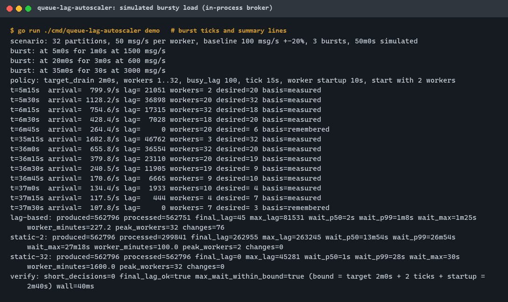
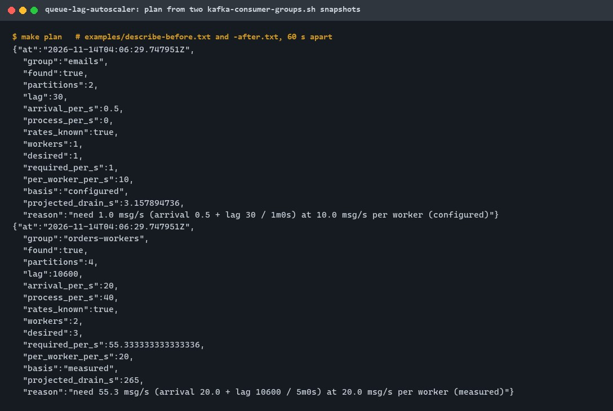
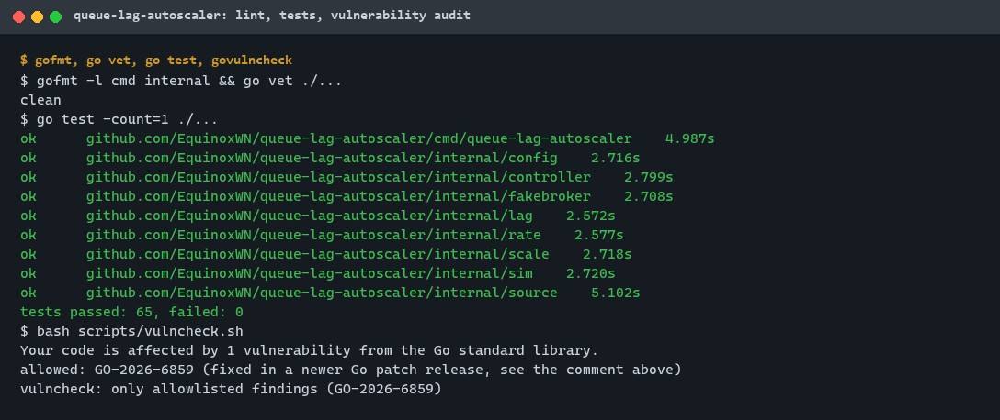
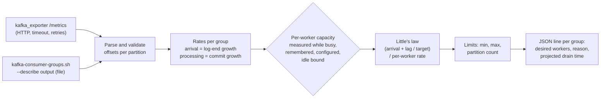
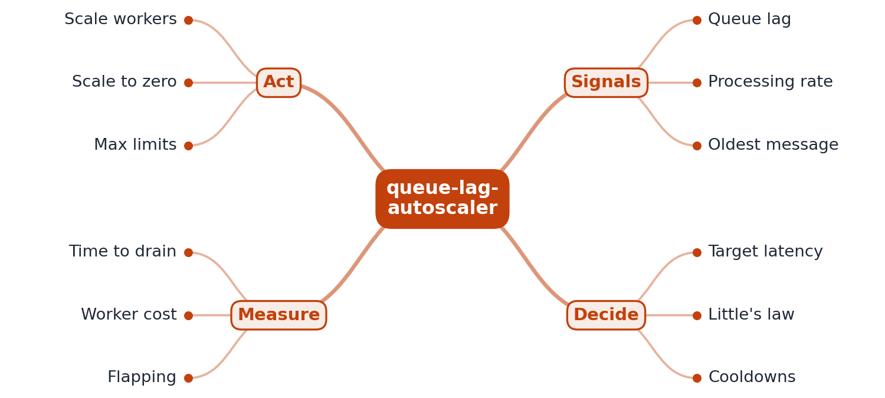

# queue-lag-autoscaler

[](https://github.com/EquinoxWN/queue-lag-autoscaler/actions/workflows/ci.yml)


> CPU-based autoscaling reacts too late to a backlog: scale workers on queue lag and processing time, so jobs finish on time without overpaying.

Part of my **DevOps and Cloud** list · Go · core project

M1 is built: a controller reads the lag, arrival rate and processing rate of each Kafka consumer
group (from kafka_exporter metrics or `kafka-consumer-groups.sh` output) and recommends the worker
count that clears the backlog within a target time, using Little's law. It prints one JSON line per
group per tick and changes nothing: applying the count to Kubernetes, stabilization and scale to
zero are on the roadmap.

## Proof it works

A simulated 50 minutes on the in-process broker (32 partitions, 50 msg/s per worker, 100 msg/s with
three bursts up to 3,000 msg/s, 10 s worker startup). The lag-based decisions keep the longest wait
at 1 min 25 s against a 2 min target, with 14% of the worker-minutes of a fleet sized for the peak;
a fleet sized for the baseline falls 27 minutes behind:



One recommendation per group from two real-format `kafka-consumer-groups.sh` snapshots 60 s apart
(`make plan`):



gofmt and go vet are clean, 65 tests pass, and govulncheck reports only one allowlisted Go
standard-library advisory (see [Tests and results](#tests-and-results)):



## Architecture

**What M1 runs today:**



**Full roadmap (M1 to M3):**



## How it works

_Steps 1 and 2 are built and tested (M1); the rest is on the [roadmap](#roadmap)._

1. A controller reads queue lag and processing rate for each consumer group.
2. It computes the workers needed to clear the backlog within a target time (Little's law), not a CPU percentage.
3. Stabilization windows and cooldowns prevent flapping when traffic is spiky.
4. Idle queues scale to zero, and hard limits cap cost.
5. A bursty load generator in kind compares this scaler with the CPU-based Horizontal Pod Autoscaler.
6. Results report time to drain, worker-minutes used and scaling oscillations.

In M1 terms:

- **Signals.** Lag per partition is `log_end - committed` (no commit yet: the whole log). Each tick
  compares the snapshot with the previous one: arrivals are the growth of log-end offsets per second
  (smoothed, `smoothing` 0.5 by default), processing is the growth of committed offsets per second
  over the last interval. A committed offset that moved backwards (reset) or a new partition adds
  nothing to that interval. Intervals use the monotonic clock.
- **Decision.** To clear L waiting messages within the target T while A per second keep arriving,
  the group needs `A + L / T` messages per second; workers = that divided by the per-worker rate,
  rounded up. Example: 12,000 waiting, 100/s arriving, T = 2 min, 40/s per worker gives
  `(100 + 100) / 40 = 5` workers.
- **Per-worker rate** ([ADR 0002](docs/adr/0002-capacity-from-busy-intervals.md)): measured only
  while the lag is above `busy_lag`, divided by the larger worker count of the interval; else the
  last measurement from an interval with a stable count; else the configured `worker_rate`; else
  the idle rate, which may lower the count but never raise it.
- **Limits.** `min_workers` (at least 1 in M1), `max_workers`, and the partition count (one consumer
  per partition in Kafka) unless `cap_to_partitions` is false. Each line says which limit applied.

## Who it helps

- **Who:** Platform and backend engineers who run Kafka consumer workers and pick their replica
  count or autoscaler settings by hand or on CPU.
- **The problem:** CPU says little about a backlog; a lag threshold per pod hides the per-worker
  speed and the time target. This tool computes the count from what the queue shows and says why,
  with the projected time to drain.
- **How to use it:** point `run` at kafka_exporter's `/metrics` (or save two `kafka-consumer-groups.sh
  --describe` outputs and use `plan`), give each group a `target_drain` and limits in a JSON file,
  and read the recommended `desired` count and `reason`; or reuse `internal/scale` (`Decide`) in
  your own controller.

## Tech stack

| Area | In M1 | Planned |
|---|---|---|
| Core | Go 1.26 standard library only (ADR 0003): control loop, rate estimator, Little's-law decision | Kubernetes controller that sets a Deployment's replicas (scale subresource) |
| Signals | kafka_exporter Prometheus metrics over HTTP; `kafka-consumer-groups.sh --describe` output | RabbitMQ queue depth, oldest-message age |
| Logic | Target drain time, capacity from busy intervals, min/max and partition limits | Stabilization windows, cooldowns, scale to zero |
| Test | Unit, randomized property (20,000 cases), HTTP failure paths, concurrency, in-process broker simulation; hand mutation testing | Bursty load in kind against the CPU-based HPA |
| CI | gofmt, go vet, `go test -race`, govulncheck, the simulation with a `::notice`; a real Kafka 4.3.1 broker feeding `plan` (not yet run) | kind cluster job |

| Path | What it is |
|---|---|
| `cmd/queue-lag-autoscaler` | CLI: `run`, `plan`, `demo` |
| `internal/lag` | Offsets per partition, the kafka_exporter and `kafka-consumer-groups.sh` parsers |
| `internal/rate` | Arrival and processing rates from successive snapshots |
| `internal/scale` | Policy validation and the worker-count decision |
| `internal/controller` | The tick: read, measure, decide per configured group; the `run` loop |
| `internal/source` | HTTP source with timeouts and bounded retries; file source |
| `internal/config` | JSON policy file loading and validation |
| `internal/fakebroker` | In-process topic and consumer group used by tests and the demo |
| `internal/sim` | The simulated bursty load behind `make bench` |
| `examples/` | Policy files and two `--describe` snapshots |

## Run it

Prerequisites: Go 1.26 or newer (CI uses 1.26.10). No Docker, broker or cluster is needed locally.

```bash
make setup   # go mod download (no third-party modules)
make lint    # gofmt and go vet
make test    # all tests with the race detector (needs cgo; without a C compiler use: go test ./...)
make audit   # govulncheck through scripts/vulncheck.sh
make demo    # the simulated run behind the numbers below (same as make bench)
make plan    # recommendations from examples/describe-before.txt and -after.txt
```

Against a live cluster (read-only; prints a line per group every 15 s):

```bash
go run ./cmd/queue-lag-autoscaler run -config examples/config.json -url http://localhost:9308/metrics
# or re-read a file you refresh with kafka-consumer-groups.sh --describe --all-groups:
go run ./cmd/queue-lag-autoscaler run -config examples/config.json -snapshot groups.txt -format describe
```

Config file (`examples/config.json`): `smoothing` (0 < a <= 1, default 0.5) and per group
`target_drain` (Go duration, 1 s to 24 h, required), `min_workers` (>= 1), `max_workers` (<= 10,000),
`workers` (current count; static in M1), `worker_rate` (msg/s per worker, optional), `busy_lag`
(default 0; set it above arrival rate x commit interval), `cap_to_partitions` (default true).
Unknown fields are refused.

Flags (no environment variables are read): `run -config -url | -snapshot -format -interval
-timeout -once -max-failures`; `plan -config -before -after -elapsed -format`; `demo -timeline`.

Output fields per line: `at` (UTC), `group`, `found`, `partitions`, `lag`, `arrival_per_s`,
`process_per_s`, `rates_known`, `workers`, `desired`, `required_per_s`, `per_worker_per_s`,
`basis`, `limit`, `projected_drain_s` (-1 = never at that count), `reason`.

## Tests and results

Latest local run (full detail in [docs/results/m1.md](docs/results/m1.md)): **65 passed, 0 failed**.

| Test file | Tests | What it proves |
|---|---|---|
| `cmd/queue-lag-autoscaler/main_test.go` | 4 | `plan` on the shipped snapshots gives the hand-computed numbers (lag 10,600, 3 workers, 265 s); `run -once` from a file and from an HTTP server; 15 bad argument sets refused; the demo's verify line holds |
| `internal/config/config_test.go` | 4 | Example files load; defaults; 18 invalid documents (unknown fields, trailing data, bad durations and ranges); 1 MiB and 1,000-group limits |
| `internal/controller/controller_test.go` | 8 | Two ticks measure and decide (60/s in, 20/s out, 12 workers); capacity divided by the larger count and remembered only from stable intervals; missing group holds; source, duplicate and worker-count errors; the loop stops after N failures, recovers, honours cancel; concurrent ticks |
| `internal/fakebroker/fakebroker_test.go` | 5 | Even produce; capacity and partition limits; fractional credit and no banking of idle time; oldest-first service and wait percentiles |
| `internal/lag/describe_test.go` | 5 | The shipped `--describe` output parses (no-commit `-`); columns found by header; 14 malformed inputs refused (including a `LAG` mismatch); 8 MiB cap |
| `internal/lag/lag_test.go` | 5 | Lag per partition (no commit, committed past the end); name and range validation; grouping refuses duplicates; ordering |
| `internal/lag/prom_test.go` | 4 | kafka_exporter fixture joins group and log-end offsets; escaped labels and timestamps; 15 malformed inputs refused; other metrics ignored |
| `internal/rate/rate_test.go` | 6 | Rates from two snapshots; resets, first commits and new partitions add nothing; non-positive intervals ignored; only arrivals are smoothed |
| `internal/scale/scale_test.go` | 10 | The worked example; float rounding at exact multiples; min, max and partition limits; capacity basis order; no-measurement hold; drain never at or below arrivals; 20,000 randomized cases sufficient and minimal |
| `internal/sim/sim_test.go` | 4 | The demo scenario meets its bound and beats both static fleets on the measure each is weak on; runs are deterministic per seed; startup delay matters; 12 invalid configs refused |
| `internal/source/source_test.go` | 10 | Retries on 503 and 429 then success; gives up after 3; no retry on 404 or parse errors; 8 MiB body cap; per-attempt timeout; cancel during backoff; URL checks; file source |

Quality check against the 10 engineering rules, with the mutation table (14 of 14 hand mutants killed after one added test case): [docs/quality/2026-11-01.md](docs/quality/2026-11-01.md).

Headline results from the simulated run on this machine:

| Result | Lag-based | Static 2 workers | Static 32 workers |
|---|---|---|---|
| Longest wait (target 2 min) | 1 min 25 s | 27 min 18 s | 30 s |
| p99 / p50 wait | 1 min 8 s / 2 s | 26 min 54 s / 13 min 54 s | 28 s / 1 s |
| Worker-minutes | 227.2 | 100.0 | 1,600.0 |
| Scaling changes | 76 (mostly 2 <-> 3; no stabilization until M2) | 0 | 0 |
| Messages left at the end | 45 | 262,955 | 0 |

| Check | Result |
|---|---|
| Demo verification | `short_decisions=0 final_lag_ok=true max_wait_within_bound=true` (bound 2 min 40 s = target + 2 ticks + startup) |
| govulncheck (Go 1.26.10) | One finding, GO-2026-6859 (net/http, fixed in Go 1.26.11), allowlisted by ID in `scripts/vulncheck.sh` until CI moves to 1.26.11; any other finding fails |

Not run locally: the race detector (needs cgo) and the real Kafka job; both run in CI, which has
not run yet for this repository. The kafka_exporter parser is tested against a fixture, not a
running exporter.

## Roadmap

**M1** (≈15 h)
- [x] Write `docs/rfc/0001-design.md`: problem, goals, non-goals, chosen design
- [x] A controller reads queue lag and processing rate for each consumer group.
- [x] It computes the workers needed to clear the backlog within a target time (Little's law), not a CPU percentage.

**M2** (≈20 h)
- [ ] Stabilization windows and cooldowns prevent flapping when traffic is spiky.
- [ ] Idle queues scale to zero, and hard limits cap cost.

**M3** (≈25 h)
- [ ] A bursty load generator in kind compares this scaler with the CPU-based Horizontal Pod Autoscaler.
- [ ] Results report time to drain, worker-minutes used and scaling oscillations.
- [ ] Publish the proof below with real numbers

## Proof

What this repo must show before it counts as done:

- Time to drain and worker-minutes vs CPU-based autoscaling under the same bursty load.

| Result | Value |
|---|---|
| M3 comparison with the CPU-based HPA in kind | Not measured yet (M3). Current M1 numbers from the simulation: see [Tests and results](#tests-and-results). |

## Why it matters

- **Interview angle:** 'Autoscale a job-processing system' and control-loop design questions.
- **Upstream I'd like to contribute to:** KEDA: scalers, docs or tests.

## Design docs

- [RFC 0001: design](docs/rfc/0001-design.md)
- [ADR 0001: record architecture decisions](docs/adr/0001-record-architecture-decisions.md)
- [ADR 0002: per-worker capacity only from busy, stable intervals](docs/adr/0002-capacity-from-busy-intervals.md)
- [ADR 0003: standard library only, and a read-only M1](docs/adr/0003-standard-library-and-read-only-m1.md)
- [M1 results](docs/results/m1.md)
- [Quality check](docs/quality/2026-11-01.md)

## Scope

This is a learning and portfolio system, not a hosted production service. Everything runs locally
against an in-process broker; a real Kafka broker is used only in CI.

Known limitations in M1: recommendations are printed, not applied; there is no stabilization, so
the count can alternate between two values near a boundary; the current worker count comes from
the config file (`workers`), not from Kubernetes; workers are assumed equal and partitions evenly
loaded; with Kafka auto-commit, `busy_lag` must be set above the lag the commit interval leaves on
an idle group, or the scaler keeps more workers than needed (never fewer).

## Security and contributing

- Every GitHub Action is pinned to a commit SHA and the Kafka image to a digest; the workflow runs read-only, without persisted credentials.
- Dependabot update pull requests are paused (`open-pull-requests-limit: 0`) so the repository keeps a single `main` branch; dependencies are updated by hand and checked by the CI audit.
- Untrusted input is bounded and validated: 8 MiB snapshots, 1 MiB configs, names, offsets, metric syntax and values; source URLs must be http(s) without credentials. The tool only reads.
- Report vulnerabilities privately: see [SECURITY.md](SECURITY.md). To contribute, see [CONTRIBUTING.md](CONTRIBUTING.md).

## License

MIT, see [LICENSE](LICENSE).
